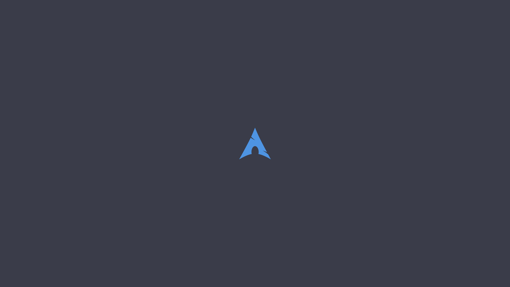

<div align="center">

# 󰣇 ARCH LINUX // OCEAN NEON

### My Personal Hyprland Desktop

**Minimalista • Cyberpunk • Azul Neon • Roxo • Transparência**


*Um ambiente Arch Linux personalizado, construído para produtividade, desenvolvimento e estética.*

</div>

---

## ✦ Sobre o projeto

Este repositório reúne as configurações do meu ambiente **Arch Linux + Hyprland**, com uma identidade visual inspirada em interfaces futuristas.

A proposta é combinar:

- Interface minimalista com detalhes neon.
- Paleta azul-ciano e roxo.
- Janelas com transparência e efeitos de blur.
- Terminal personalizado com dashboard.
- Barra de tarefas com módulos e scripts próprios.
- Tela de bloqueio e login temáticas.
- Configurações versionadas para facilitar recuperação e migração.

## 🎨 Identidade visual

| Elemento | Estilo |
|---|---|
| Cor principal | `#38BDF8` — azul neon |
| Cor secundária | Roxo / lilás |
| Ambiente | Dark / Cyberpunk |
| Janelas | Transparência e blur |
| Terminal | Dashboard Arch personalizado |
| Tela de login | Astronaut Lofi |
| Tela de bloqueio | Astronaut Neon |

## 🖥️ Componentes

| Componente | Tecnologia |
|---|---|
| Sistema operacional | Arch Linux |
| Compositor Wayland | Hyprland |
| Barra de status | Waybar |
| Terminal | Kitty |
| Prompt | Starship |
| Shell | Bash |
| Launcher | Rofi |
| Tela de bloqueio | Hyprlock |
| Gerenciador de login | SDDM |
| Wallpapers | Hyprpaper |
| Listagem de arquivos | eza + script personalizado |

## 📸 Wallpapers

<div align="center">

### Astronauta Neon


### Wallpaper principal



</div>

## 📁 Estrutura

```text
archlinux-dotfiles/
├── README.md
├── .gitignore
├── docs/
│   ├── instalacao.md
│   ├── atalhos.md
│   └── recuperacao.md
├── configs/
│   ├── bash/
│   ├── hypr/
│   │   └── astronaut-preview/
│   ├── kitty/
│   ├── rofi/
│   ├── scripts/
│   ├── sddm/
│   │   └── astronaut-lofi/
│   ├── starship/
│   └── waybar/
│       └── scripts/
└── wallpapers/
```

## ✨ Destaques

### Hyprland
Configuração personalizada em Lua, gerenciamento de janelas, atalhos e efeitos visuais.

### Kitty
Terminal com tema escuro, transparência e scripts para dashboard de informações do sistema.

### Waybar
Barra personalizada com controles, informações do sistema e scripts de brilho, wallpaper e configurações.

### Starship
Prompt com identidade visual Arch Linux, informações de diretório e Git.

### SDDM + Hyprlock
Telas de login e bloqueio personalizadas com temática de astronauta.

### Scripts
Ferramentas auxiliares para interação com o desktop e listagem colorida de diretórios.

## 🚀 Instalação e recuperação

Este repositório contém os arquivos de configuração, mas **não é um instalador automático**.

Consulte:

- [Instalação e dependências](docs/instalacao.md)
- [Atalhos e personalizações](docs/atalhos.md)
- [Recuperação do ambiente](docs/recuperacao.md)

> **Atenção:** alguns arquivos usam caminhos absolutos `/home/gabriel/`. Adapte-os ao seu usuário antes de aplicar as configurações em outro computador.

## 🧩 Objetivo

Manter uma referência versionada e organizada do meu ambiente para que eu possa reconstruí-lo após uma reinstalação, migração ou mudança de hardware.

---

<div align="center">

**Built with Arch Linux, Hyprland & a little neon.**

`ARCH // OCEAN NEON`

</div>
